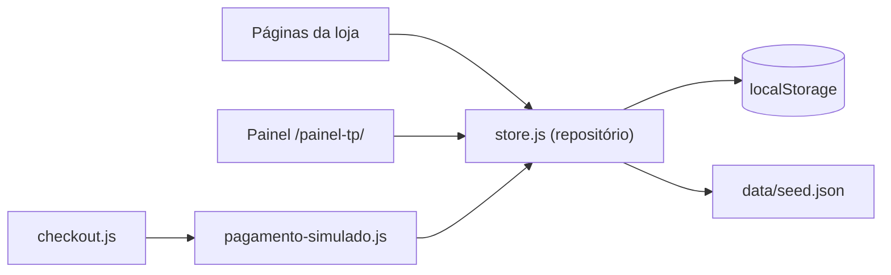

# Thaís de Paula Ateliê · Site + Loja (demonstração)

**Perfil:** S1 + S3 (institucional com catálogo) + e-commerce **demo** → arquitetura-blindada **P1-demo** (sem dinheiro real, sem backend; dados no navegador).
**Direção:** `design-taste-frontend` (base) + `high-end-visual-design` · Vibe *Editorial Luxury* adaptada à marca · Layout *Z-Axis Cascade* (polaroides empilhadas) · **Dials V6 / M5 / D4**
**Design read:** loja de papelaria artesanal para mães, noivas, professoras e quem presenteia, com linguagem delicada e floral em aquarela, puxando para editorial suave com tipografia de convite.

---

## FASE 1 · PROJETAR

### Negócio e objetivo
- Apresentar o ateliê e cada linha de produto (as 8 do flyer).
- Vender em dois modos: **Pronta entrega** (estoque, envio rápido) e **Sob demanda** (personalizado, prazo de produção).
- Métrica da demo: o cliente consegue ir do catálogo ao pedido confirmado em menos de 2 min; a dona consegue ver e mover o pedido no painel.

### Ativos reais (das imagens)
| Item | Valor |
|---|---|
| Marca | Thaís de Paula Ateliê · monograma **TP** |
| Slogan | "Transformando papel em momentos especiais." |
| Valores | Qualidade · Carinho · Personalização · Feito com Amor |
| Instagram | @thaisdepaulatelie |
| WhatsApp | (43) 98422-1611 |
| Paleta | blush/pêssego, marrom cacau, rosa aquarela, verde sálvia, fio dourado |
| Produtos | Cadernos, Blocos de anotações, Lápis personalizados, Fotos polaroide, Quadros em MDF, Adesivos, Etiquetas escolares, Ímãs de geladeira |

### Mapa do site
| Página | Conteúdo |
|---|---|
| `index.html` | Hero · as 8 linhas · Pronta entrega × Sob demanda · Como funciona a personalização · Destaques da loja · Sobre o ateliê · FAQ · Contato |
| `loja.html` | Catálogo com filtros (linha, modo, preço), busca e ordenação |
| `produto.html?p=slug` | Galeria, preço, modo, opções de personalização (nome, tema, cor, foto com prévia), quantidade, prazo estimado, relacionados |
| Carrinho (gaveta lateral) | Itens, personalização resumida, cupom, subtotal |
| `checkout.html` | Dados · entrega (retirada / envio com frete simulado por CEP) · pagamento **simulado** (Pix com QR fictício, cartão de teste, boleto fictício) |
| `pedido.html?id=` | Confirmação + linha do tempo do status |
| `politica-de-privacidade.html`, `404.html` | Obrigatórios |
| **Painel oculto** `/painel-tp/` | Sem link no site, `noindex`, acesso por PIN de demo |

### Painel admin (oculto)
- **Visão geral:** faturamento simulado, nº de pedidos, ticket médio, gráfico de 14 dias, pedidos aguardando ação.
- **Pedidos:** lista, filtro por status, detalhe com personalização e foto enviada, mudar status (Aguardando pagamento → Pago → Em produção → Pronto → Enviado/Retirado → Concluído / Cancelado).
- **Produtos:** criar, editar, ativar/desativar, destaque, preço, estoque (pronta entrega), prazo em dias úteis (sob demanda), opções de personalização.
- **Cupons:** % ou valor fixo, validade, ativo.
- **Configurações:** WhatsApp, frete fixo/grátis acima de X, prazo padrão.
- **Ferramentas:** exportar pedidos em CSV, restaurar dados de demonstração.

### Premissas (preciso que você confirme ou corrija)
1. **Preços:** uso valores **ilustrativos** marcados como demo (ex.: caderno A5 R\$ 59,90). Se tiver a tabela real, troco.
2. **Cidade/endereço e CNPJ:** não aparecem nas imagens. Vou mostrar só WhatsApp e Instagram e deixar "Retirada combinada pelo WhatsApp".
3. **Depoimentos:** não invento. Sem seção de depoimentos até você enviar reais.
4. **Fotos dos produtos:** gero fotos no estilo do flyer (aquarela rosa, mesa clara) com o gerador de imagens. São ilustrativas, não fotos do ateliê.
5. **Logo:** recrio o wordmark em fonte script para ficar nítido; uso as imagens originais no "Sobre" e no rodapé.
6. **PIN do painel na demo:** `2611` (exibido no README, não no site).

> **Gate 1:** ok, desde que as premissas 1 a 6 sejam aceitas.

---

## FASE 2 · ARQUITETAR

### Stack
| Camada | Escolha | Descartado |
|---|---|---|
| Páginas | HTML semântico multi-page | SPA (SEO e peso piores) |
| Estilo | CSS puro com tokens (`clamp`, `:has`, container queries) | Tailwind CDN |
| Lógica | JS ES modules, sem framework | React (desnecessário para demo estática) |
| Motion | GSAP 3 + ScrollTrigger + Lenis, **arquivos locais** | libs genéricas de AOS |
| Dados | `localStorage` com seed JSON + camada `store.js` (repositório) | Backend real (fora do escopo da demo) |
| Ícones | Phosphor Light (SVG sprite local) | Font Awesome |
| Hospedagem | Qualquer estático (Vercel/Netlify) com cabeçalhos de segurança | |



### Estrutura
```
index.html loja.html produto.html checkout.html pedido.html
politica-de-privacidade.html 404.html
painel-tp/index.html
css/ tokens.css base.css layout.css components.css shop.css admin.css
js/  main.js motion.js store.js cart.js catalog.js product.js checkout.js
     payment-sim.js order.js format.js dom.js admin/*.js vendor/
data/seed.json
img/ (produtos, hero, sobre, og)   fonts/ (woff2 locais)
robots.txt sitemap.xml llms.txt site.webmanifest favicons og-image.jpg
vercel.json _headers  README.md  docs/
```

### Modelo de dados (localStorage)
- `products`: id, slug, name, line, mode (`pronta`|`demanda`), price (centavos), stock, leadDays, options[], images[], active, featured
- `orders`: id (TP-AAAA-####), items[{productId, qty, unitPrice, personalization}], customer, shipping, coupon, totals, payment{method, status}, status, history[]
- `coupons`, `settings`

**Regra:** preço e total são **recalculados a partir do catálogo** no checkout, nunca lidos do carrinho (simula a regra de servidor).

### Design system
| Token | Valor |
|---|---|
| Fundo | `#FBEDE6` blush · superfície `#FFF8F4` |
| Texto | `#4A2A20` cacau (contraste AA) · secundário `#7A5143` |
| Acento único | rosa `#D9787F` (botões em cacau para contraste) |
| Apoio | sálvia `#8FA588` (detalhes), fio dourado `#C6A06A` (linhas finas) |
| Fontes | Wordmark: **Allura** (script) · Títulos: **Cormorant Garamond** (justificado: a marca usa serifa em "ATELIÊ") · Texto: **Figtree** |
| Raios | cartões 24px com *double-bezel* · botões pílula · inputs 14px |
| Sombras | difusas tingidas de rosa, nunca preto |
| Curva | `cubic-bezier(0.32,0.72,0,1)`, 500 a 900 ms |

> [!NOTE]
> A paleta bege/rosa normalmente é vetada como "padrão de IA", mas aqui é a identidade real da marca (flyer e cartões), então a exceção é justificada.

### Motion por seção (todas com fallback `prefers-reduced-motion`)
| Seção | Animação |
|---|---|
| Hero | polaroides entram em cascata com leve rotação; parallax suave no mouse (desktop) |
| 8 linhas | bento assimétrico, revelação em stagger; cartão com tilt/spotlight |
| Pronta × Sob demanda | dois painéis com troca animada (toggle) |
| Como funciona | passos fixados (pin) com progresso no scroll, só desktop |
| Loja | filtros com transição de layout (FLIP) |
| Carrinho | gaveta com mola; contador "pula" ao adicionar |
| Checkout | Pix: QR com contagem regressiva e "pagamento confirmado" animado |

### SEO
- Title/description únicos por página, canonical, OG/Twitter, `Store` + `Product` JSON-LD (com aviso de demo), sitemap, robots, llms.txt.
- Painel: `noindex,nofollow`, fora do sitemap, **não citado** no robots (para não revelar o caminho).

### Threat model (demo)
| Risco | Mitigação |
|---|---|
| XSS via nome/personalização/admin | Nunca `innerHTML` com dado do usuário; só `textContent`/criação de nós |
| Adulterar preço no carrinho | Total recalculado do catálogo |
| Upload de foto pesada/maliciosa | Só imagem, máx. 5 MB, redimensionada em canvas para ≤ 1200px, fica local |
| Dados de cartão | Só cartões de teste aceitos; número nunca é salvo (guarda só bandeira + 4 finais) |
| Painel "oculto" | **PIN no cliente não é segurança.** Documentado: produção exige backend com auth real |
| Scripts de terceiros | Nenhum. Tudo local, CSP `default-src 'self'` sem `unsafe-eval` |

> [!WARNING]
> Para virar loja real: Supabase (Auth + Postgres + RLS + Storage), gateway (Mercado Pago/Pagar.me) com webhook assinado, LGPD. Isso é outra rodada (perfil P2).

---

## FASE 3 · PLANO DE IMPLEMENTAÇÃO

| # | Etapa | Arquivos | Pronto quando | Risco |
|---|---|---|---|---|
| 1 | Base, segurança, SEO raiz, fontes e vendors locais | raiz, `vercel.json`, `_headers`, `fonts/`, `js/vendor/` | HTML válido, CSP ativa | baixo |
| 2 | Tokens, base, componentes (botões, cards, inputs, header ilha, footer) | `css/*` | 360/768/1280 ok | baixo |
| 3 | Imagens: gerar 13 imagens + otimizar WebP, favicons, OG | `img/`, ícones | pesos dentro do alvo | médio |
| 4 | Home completa + motion | `index.html`, `motion.js` | hero no 1º viewport, sem CLS | médio |
| 5 | Dados e store (seed, repositório, formatação BRL) | `data/`, `store.js`, `format.js` | CRUD funcionando no console de teste | baixo |
| 6 | Loja + produto + personalização + carrinho | `loja.html`, `produto.html`, `catalog/product/cart.js` | fluxo add→carrinho ok | médio |
| 7 | Checkout + pagamentos simulados + pedido | `checkout.html`, `pedido.html`, `payment-sim.js` | Pix/cartão/boleto geram pedido | médio |
| 8 | Painel oculto completo | `painel-tp/`, `js/admin/*`, `admin.css` | pedidos/produtos/cupons/config/CSV | médio |
| 9 | Revisão adversarial (segurança, a11y, copy sem travessão, AI tells) | todos | zero 🔴 | baixo |
| 10 | Auditoria (`validar_site.py`, teste no navegador) + README | `docs/relatorio-auditoria.md` | Score ≥ 85, zero veto | baixo |

**Mídia:** `docs/script-imagens.md` (13 imagens). Vídeo Flow: não se aplica nesta demo.

**Fora desta rodada:** backend real, e-mail transacional, cálculo real de frete (Correios), login de cliente, emissão de nota.

**Checkpoints:** depois da Home (etapa 4) e antes da auditoria.

**Aguardando sua aprovação (e as premissas 1 a 6) para iniciar a Etapa 1.**
